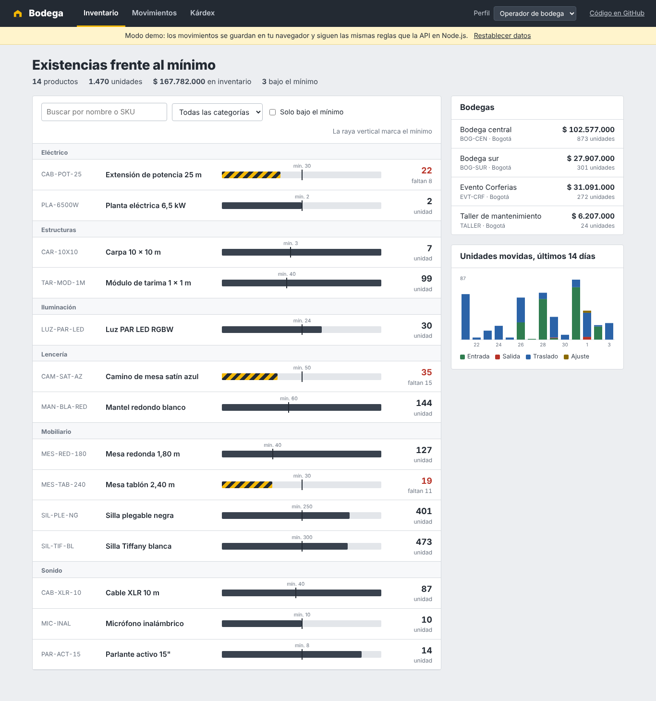
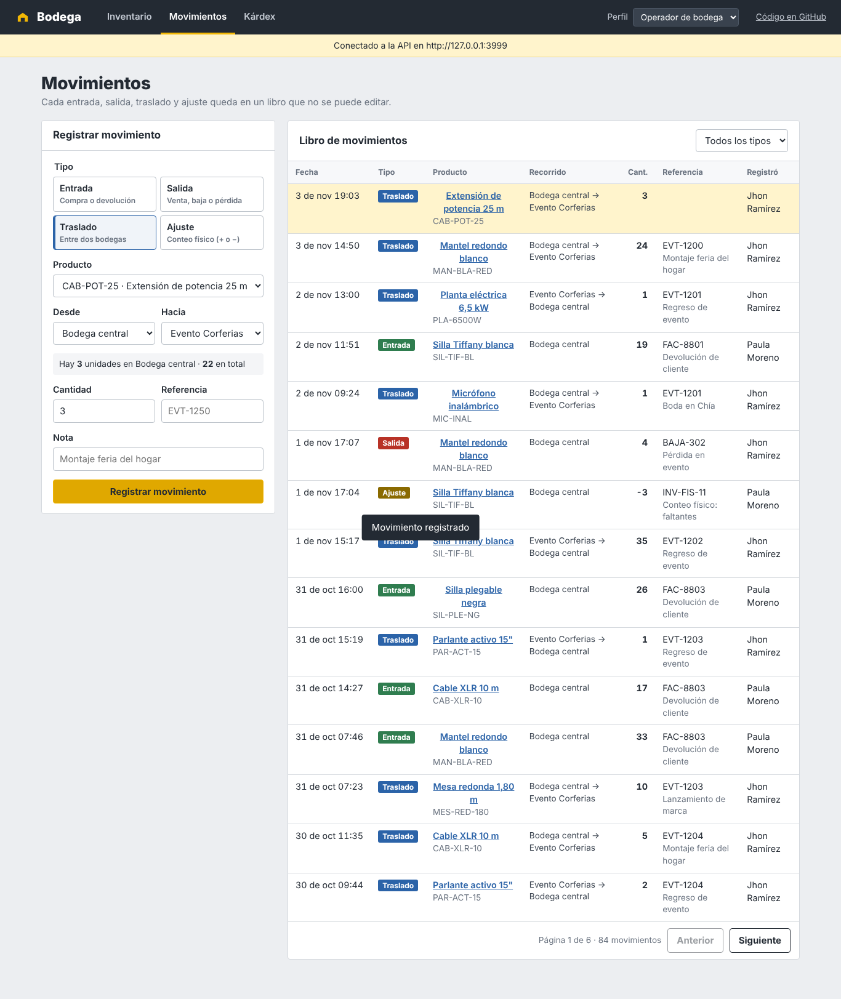
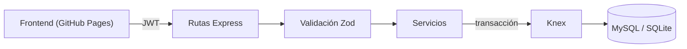

# Bodega · API de inventario multibodega con Node.js

API REST para controlar el inventario de una empresa de alquiler de mobiliario y equipos para eventos: existencias por bodega, traslados a eventos, salidas por daño, ajustes por conteo físico y un kárdex con el saldo después de cada movimiento. Incluye un frontend publicado en GitHub Pages que funciona en modo demo sin servidor.

**[Ver la demo en vivo](https://xaleejossj.github.io/inventario-node-api/)** · [Documentación Swagger (local)](http://localhost:3000/docs)




## Qué resuelve

Cuando el inventario se lleva en hojas de cálculo, nadie sabe con certeza cuántas sillas quedaron en el evento, cuáles están en el taller o quién registró una salida. Bodega convierte cada cambio de existencias en un **movimiento** que queda en un libro inmutable:

| Tipo | Uso | Regla |
| --- | --- | --- |
| Entrada | Compras y devoluciones | Requiere bodega destino |
| Salida | Bajas por daño, pérdidas, ventas | Requiere existencias suficientes en el origen |
| Traslado | Bodega central → evento → bodega central, envíos al taller | Origen y destino distintos; no cambia el total |
| Ajuste | Diferencias del conteo físico | Puede ser negativo, pero el saldo nunca queda bajo cero |

Las existencias solo cambian a través de movimientos, y cada movimiento se registra dentro de una **transacción**: si algo falla, no queda nada a medias. En MySQL la fila del saldo se bloquea con `SELECT ... FOR UPDATE` para que dos operadores no despachen las mismas unidades al mismo tiempo.

## Funcionalidades

- Existencias por producto y bodega, con alerta cuando quedan por debajo del mínimo.
- Kárdex por producto, total o filtrado por bodega, con saldo acumulado.
- Libro de movimientos con filtros por tipo, producto, bodega y rango de fechas, paginado.
- Auditoría de cambios en el catálogo: guarda el valor anterior y el nuevo de cada edición.
- Valor del inventario por bodega y actividad de los últimos 14 días.
- Exportación del catálogo a CSV (separado por `;` para abrirlo directo en Excel).
- Roles: **Administración** (todo), **Operador** (registra movimientos y edita el catálogo) y **Consulta** (solo lectura).
- Seguridad: JWT, contraseñas con bcrypt, `helmet`, CORS por lista blanca y límite de intentos de login.
- Errores con formato estándar RFC 7807 y validación de entrada con Zod.



## Arquitectura



```
backend/
├── src/
│   ├── app.js                 Construye la app (inyecta la conexión: facilita las pruebas)
│   ├── server.js              Arranque, migración y apagado ordenado
│   ├── config.js              Variables de entorno
│   ├── db/                    Conexión, esquema y datos de ejemplo
│   ├── middleware/            Autenticación JWT, roles y validación
│   ├── routes/                Endpoints y esquemas de Zod
│   └── services/              Reglas de inventario, catálogo y tablero
├── test/                      Pruebas de integración con supertest
└── openapi.yaml               Especificación servida en /docs
```

Knex permite usar **MySQL en producción y SQLite en desarrollo y pruebas** con el mismo código, así que el proyecto corre sin instalar una base de datos.

## Endpoints

| Método | Ruta | Roles | Descripción |
| --- | --- | --- | --- |
| POST | `/api/auth/login` | Público | Token JWT |
| GET | `/api/products` | Todos | Productos con existencias; filtros `search`, `category`, `lowStock` |
| POST | `/api/products` | Admin, Operador | Crea un producto |
| PATCH | `/api/products/:id` | Admin, Operador | Edita y registra la auditoría |
| DELETE | `/api/products/:id` | Admin | Desactiva (conserva el historial) |
| GET | `/api/products/:id/kardex` | Todos | Kárdex, opcionalmente por bodega |
| GET | `/api/products/:id/history` | Todos | Cambios del catálogo |
| GET | `/api/products/export.csv` | Todos | Exporta a CSV |
| GET | `/api/movements` | Todos | Libro de movimientos con filtros |
| POST | `/api/movements` | Admin, Operador | Registra un movimiento |
| GET | `/api/warehouses` | Todos | Bodegas con unidades y valor |
| GET | `/api/dashboard` | Todos | Totales, alertas y actividad |

## Cómo ejecutarlo

### Opción 1: Node.js con SQLite (sin instalar nada más)

```bash
cd backend
npm install
npm run dev
```

La API queda en `http://localhost:3000` y Swagger en `http://localhost:3000/docs`. Los datos de ejemplo se cargan solos la primera vez.

### Opción 2: Docker Compose con MySQL

```bash
docker compose up --build
```

Levanta MySQL 8.4, la API en el puerto 3000 y el frontend en `http://localhost:8082`.

### Usuarios de prueba

Todos usan la contraseña `Demo1234*`: `admin@bodega.co`, `operador@bodega.co` y `consulta@bodega.co`.

### Conectar el frontend a la API

El frontend está en `docs/` y por defecto corre en modo demo. Para usar la API real, edita `docs/config.js`:

```js
window.BODEGA_CONFIG = { API_URL: "http://localhost:3000" };
```

## Pruebas

```bash
cd backend
npm test
```

16 pruebas de integración con `node:test` y `supertest` sobre SQLite en memoria. Cubren permisos por rol, traslados que conservan el total, salidas sin existencias, ajustes que dejarían saldo negativo, validación de datos, kárdex que cuadra con las existencias, SKU duplicado, auditoría y exportación a CSV.

GitHub Actions corre las pruebas en cada push y además migra y siembra los datos sobre un MySQL 8.4 real (`.github/workflows/ci.yml`).

## Despliegue de la demo

`.github/workflows/pages.yml` publica `docs/` en GitHub Pages. Para activarlo: **Settings → Pages → Source: GitHub Actions**.

## Tecnologías

Node.js 22 · Express 4 · Knex · MySQL 8 · SQLite · Zod · JSON Web Tokens · bcrypt · Helmet · Swagger UI · node:test · supertest · Docker · GitHub Actions · HTML, CSS y JavaScript (módulos ES, gráficas en SVG sin librerías)

## Autor

**David Alejandro Sánchez Jaimes** · Desarrollador de Software Backend
[LinkedIn](https://www.linkedin.com/in/david-alejandro-sanchez-jaimes-622a94313/) · [GitHub](https://github.com/xaleejossj)
